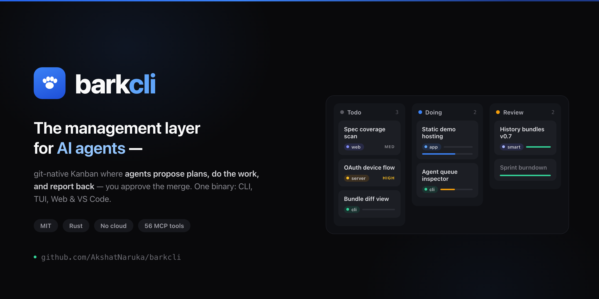
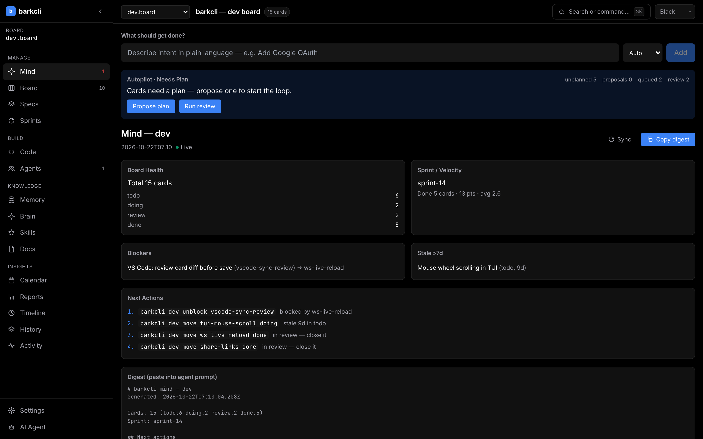
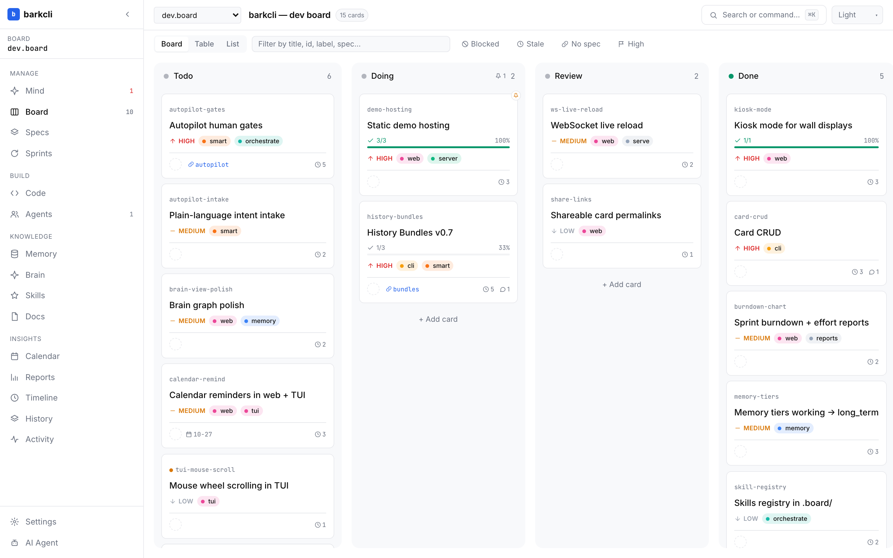
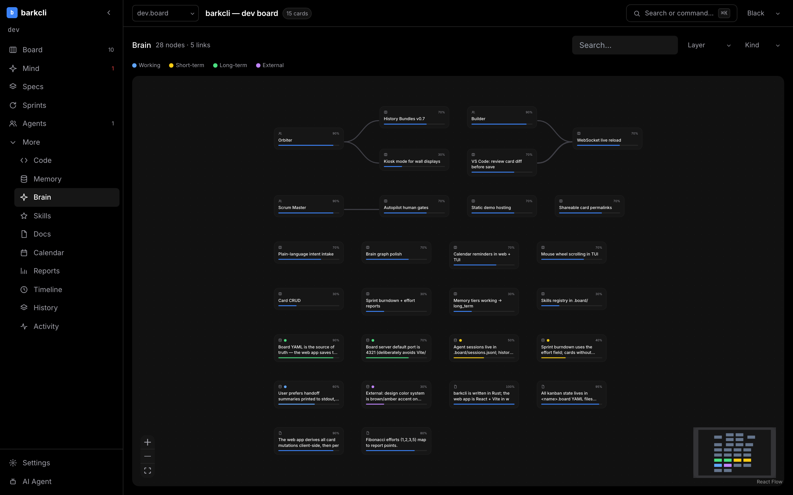
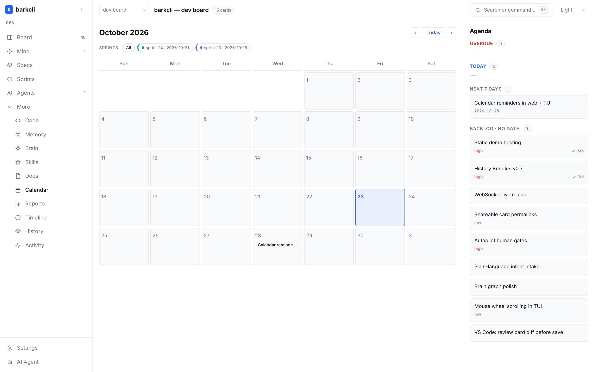
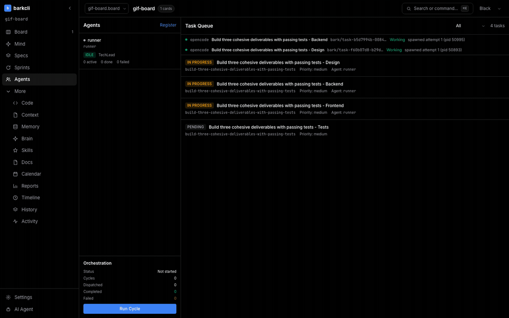

<div align="center">

# 🐕 barkcli

**The management layer for AI agents.**

You decide *what* gets built. Agents propose plans, do the work, and report back. barkcli runs the pipeline: **intake → plan → dispatch → review → merge**. Tasks, specs, memory, skills, and agent runs live in your repo — no cloud, no accounts, no subscriptions.



[](LICENSE)
[](https://crates.io/crates/barkcli)
[](https://www.rust-lang.org)
[](#)
[](#)
[](#)
[](https://github.com/AkshatNaruka/barkcli/releases)
[](https://github.com/AkshatNaruka/barkcli/actions/workflows/ci.yml)
[](CONTRIBUTING.md)

[Install](#install) · [Quick Start](#quick-start) · [Docs](https://akshatnaruka.github.io/barkcli/docs) · [Web App](https://akshatnaruka.github.io/barkcli) · [Live Site](https://akshatnaruka.github.io/barkcli/) · [Live Web Demo](https://akshatnaruka.github.io/barkcli/app/) · [Comparisons](https://akshatnaruka.github.io/barkcli/compare) · [Discussions](https://github.com/AkshatNaruka/barkcli/discussions)

</div>

---

## Table of Contents

- [Why barkcli?](#why-barkcli)
- [Features](#features)
- [Interactive Threads & Live Surfaces](#interactive-threads--live-surfaces)
- [Modern T3-Style Analytics](#modern-t3-style-analytics)
- [Trust layer](#trust-layer)
- [Collective memory](#collective-memory)
- [Screenshots](#screenshots)
- [Install](#install)
- [Quick Start](#quick-start)
- [The Autopilot Loop](#the-autopilot-loop)
- [CLI Reference](#cli-reference)
- [AI Agent Integration](#ai-agent-integration)
- [Interfaces](#interfaces)
- [Documentation](#documentation)
- [Benchmarks & Comparisons](#benchmarks--comparisons)
- [Architecture](#architecture)
- [Development](#development)
- [Roadmap](#roadmap)
- [Contributing](#contributing)
- [Community](#community)
- [License](#license)

---

## Why barkcli?

Intent in, plans out. barkcli is **the management layer for AI agents**: humans write intent, agents propose plans, each agent works in an isolated git worktree, your tests are the acceptance gate, and only passing branches merge. Tasks, specs, memory, skills, and agent runs live in your repo — no cloud, no accounts, no subscriptions.

| Serial Terminal CLIs (Claude Code, OpenCode, Codex) | barkcli Management Layer |
|---|---|
| **Single Working Tree**: Agents mutate your current uncommitted files directly, causing dirty diffs, conflicts, and state contamination. | **Isolated Git Worktrees**: Every agent attempt runs inside an isolated `.worktrees/` sandbox. Your active working tree remains untouched. |
| **Self-Reported Success**: "I have fixed the issue" (often hallucinated or untested). | **Acceptance Gate as True Contract**: Done = project tests pass in the worktree (`cargo test`, `pytest`, `npm test`). No pass = no merge. |
| **Serial Babysitting**: Runs one task at a time; you wait in a terminal loop. | **Parallel Pool & Merge Train**: `--agents N` spawns parallel worktrees. Passing branches merge in order; conflicted branches re-run solo. |
| **Context Amnesia**: Every new chat window starts from scratch or drowns in 100k+ token dumps. | **Living Context & 4-Tier Memory**: Self-healing `project_context.md` + long-term gotchas and conventions persist across agent sessions. |
| **Zero Audit Trail**: Cloud blackbox or lost scrollback. | **Deterministic Trust Layer**: `barkcli guard` scans for leaked secrets and hazardous patterns; SHA-256 receipts verify exactly what shipped. |

---

## Features

| | |
|---|---|
| 💬 **Interactive Threads** | Multi-turn agent collaboration with live tool-calling streams, a left-rail dashed timeline scrubber to inspect earlier execution checkpoints, and full thread history. |
| ❓ **In-Thread Questions** | Agents ask structured questions (options, multi-select, a recommended pick, plus "type your own answer") and request missing credentials without leaving the conversation. Answers resume the same turn; secrets go to local settings, never into the thread or the model. |
| ⚙️ **Settings That Apply** | Every Settings pane changes real behavior: API keys and custom env vars are injected into every agent process and shell, the shell powers the embedded terminal, and your default agent/model seeds new threads. Stored in `~/.bark/settings.json`. |
| 🌐 **Inbuilt Web Browser** | Full-fledged embedded browser surface: test and interact with local development servers (`http://localhost:*`), preview web apps, and inspect documentation directly inside Bark. |
| 🚀 **Floating Surface Launcher** | Fast launcher menu to open Browser, Terminal, Files, Diff, Pull Requests, Linked PRs, Devices, and Side Chats in clean, closable tabs. |
| 📊 **Modern T3-Style Analytics** | Interactive column throughput and effort metrics with SVG linear gradients, view filters (`All`, `Cards`, `Effort`), glassmorphic tooltips, and Donut priority charts with centered totals. |
| 🧠 **Codebase Brain (3D & 2D)** | Structural architecture graph discovering subsystems, modules, services, APIs, and invariants. Rendered in glowing 3D Orbit, 2D Flow, and contribution timeline. |
| 🛡 **Deterministic Trust Layer** | `barkcli guard` pre-merge security scan (secrets, dangerous patterns, missing tests) + cryptographic SHA-256 receipts (`barkcli receipt show`) proving who built what and what passed. |
| 🤖 **Autonomous Autopilot Loop** | `barkcli run "<intent>" --agents 3 --yes` — parallel agents in isolated git worktrees, your project's tests as the gate, and an atomic merge train for passing branches. |
| ⚡ **Living Context Engine** | Self-healing `project_context.md` auto-maintained by `barkcli context digest`. Reduces cold-start agent token consumption by **57×**. |
| 🛠 **MCP Server (76 Tools)** | First-class JSON-RPC 2.0 server for Claude Code, OpenCode, Codex, and Cursor covering boards, cards, tasks, memory, specs, and orchestration. |
| 🧬 **Collective Memory** | Agora-inspired contribution DAG backed by Git. Evidence scores, independent reproduction, neglected-branch nudging, and UCB recommendations. |
| 📦 **Skills Registry** | Composable playbooks injected into agent prompts on trigger matches. Install from git repos with sha256-pinned `skills.lock`. |
| 💻 **Native macOS Desktop App** | Tauri v2 desktop application (`Bark.app`) packaging the web UI with native macOS menubar, window controls, and automated background update checks on release. |
| 📋 **Board + Spec Traceability** | Kanban boards with `spec_id` linkage — specs ↔ cards ↔ code in O(1). Diff it, merge it, version-control it. |
| ⏱ **Timeline & Rollback** | Checkpoints, undo, diff, blame, validate, doctor. Your board, completely version-controlled with zero cloud lock-in. |

---

## Interactive Threads & Live Surfaces

> **Never lose track of agent decisions, tool invocations, or running servers.**

Bark includes a built-in multi-surface workbench directly within the desktop and browser interfaces:

- **Left-Rail Execution Timeline Scrubber**: An interactive vertical dashed line tracks every action an agent takes during a thread run. Hovering over any notch instantly exposes the exact tool call, file edit, or command executed at that point in time with full context.
- **Inbuilt Web Browser**: An embedded web browser running directly inside Bark. Test and interact with local development servers (`http://localhost:*` or your API dev servers) as well as remote documentation and web applications without leaving your workspace or switching windows.
- **Floating Surface Launcher**: Instant shortcut-driven launcher menu ("Open a surface") with dedicated keys for fast navigation:
  - `B` — **Browser** (live web & localhost testing)
  - `T` — **Terminal** (embedded interactive terminal)
  - `F` — **Files** (source code tree explorer with quick preview)
  - `D` — **Diff** (granular unified & side-by-side git diff view)
  - `P` — **Pull request** (GitHub PR inspect, review, and merge)
  - `L` — **Linked pull requests** (multi-branch and stacked PR review)
  - `M` — **Device** (mobile and responsive device simulators)
  - `S` — **Side chat** (parallel agent and thread queries)
- **Tabbed Surface Management**: Open multiple surfaces as independent tabs with clean close buttons, persistence across workspace changes, and seamless switching without closing background jobs.
- **Questions in the Thread, Not a Modal**: When an agent is blocked it ends its turn with a structured block that Bark lifts out of the reply and renders as a dock above the composer — one tab per question, numbered options in the agent's recommended order, multi-select when several apply, an automatic "type your own answer", and a credential form for keys the agent is missing. Skipping keeps the question in the log; answering appends an immutable `answer` event and resumes the agent with the same provider session. Nothing is lost if the app closes while a question is open.

---

## Modern T3-Style Analytics

> **Executive-grade delivery tracking built for engineering leads and autonomous agent fleets.**

- **Column Throughput & Effort Chart**: Interactive dual-gradient bars (`#10b981` emerald for cards, `#6366f1` indigo for story point effort) tracking work movement across all board columns.
- **Metric View Mode Toggles**: Instant segmented filters (`All`, `Cards`, `Effort`) allowing teams to drill into card counts, total effort, or both side-by-side.
- **Glassmorphic Custom Tooltips**: Dark-theme tooltips providing card count share %, story points share %, and calculated average complexity per card.
- **Priority Donut Chart**: Modern donut chart with centered live card counts and glowing indicators for High, Medium, and Low priorities.
- **Zero Glare Hover**: Dark-theme hover cursor preventing light-mode glare artifacts in high-contrast dark workspaces.

---

## Trust layer

> **Agents write code. barkcli proves it.**

The bottleneck is no longer writing the diff — it is trusting it. Three commands close that gap without a cloud service or an LLM in the decision path:

```bash
barkcli guard                 # deterministic pre-merge scan (secrets, deps, tests, danger)
barkcli receipt show <card>   # what shipped, who wrote it, what passed, and a SHA-256
barkcli review next           # the riskiest card waiting for review
```

`barkcli guard` checks the diff for hardcoded secrets, undeclared or suspicious dependencies, lockfile drift, dangerous patterns (`eval`, `shell=True`, raw SQL), debug leftovers, missing tests, and oversized diffs. It is **advisory by default**; set `"guard": { "block": true }` in `.board/config.json` to make errors block a merge. It also runs standalone in any git repo.

Every merge through `barkcli run` writes a **receipt** to `.board/receipts/`: the intent, agent, branch and head SHA, diff stats, gate verdict, guard findings, review counts, a confidence level with reasons, and a content hash. `barkcli receipt verify` recomputes the hash and checks whether the branch moved — so a receipt can be audited later, on another machine, without trusting the agent that produced it. Receipts are local-first in v1; `receipt show` renders Markdown for sharing.

`barkcli review queue` ranks cards in review by risk — security-sensitive paths, complexity, missing tests, churn, public API changes, and size — and `review next` picks the one to open first. The web app has the same surfaces: a **Receipt** tab in the workbench and a **Review queue** panel on the board.

---

## Collective memory

> **Git isn't just version control for code — it's memory for autonomous agents.**

Inspired by NVIDIA's *Agora* (arXiv:2609.18094), barkcli records every run as an
immutable node in a contribution DAG:

- **Parent edges** show what each claim builds on.
- **Independent reproduction** is a first-class action; self-verification is rejected.
- **Evidence scores** grow from reproductions and reuse by other agents.
- **Neglected branches** and **contested claims** are surfaced automatically.
- **UCB recommendations** balance refining the leader with exploring the long tail.
- **MCP tools** let Claude Code, OpenCode, and Cursor publish, link, and verify contributions.

The graph is always on and rebuildable from `.board/runs/`. Old runs load as flat
result nodes.

---

## Screenshots

| **Mind — the compiled project snapshot** | **Board — the work, with spec traceability** |
|:---:|:---:|
|  |  |

| **Brain — the memory knowledge graph** | **Calendar — deadline-first** |
|:---:|:---:|
|  |  |

Try it live without installing — [**the Web demo**](https://akshatnaruka.github.io/barkcli/app/) runs the full interface on demo data (every interaction works), or [**watch a recorded 3-agent run**](https://akshatnaruka.github.io/barkcli/app/?run=replay#/mind) in the real Mind view — live agent rows, gate verdicts, and the merge train.

---

## Install

### One-liner (macOS & Linux)

```bash
curl -fsSL https://github.com/AkshatNaruka/barkcli/releases/latest/download/install.sh | sh
```

### Homebrew

```bash
brew tap AkshatNaruka/barkcli && brew install barkcli
```

### Cargo

```bash
cargo install barkcli
```

### Remote / mobile access

Bark is local-first. To reach it from a phone or another machine on your LAN:

```bash
barkcli serve --host 0.0.0.0 --open
```

Then open the printed URL (with its token) on the other device. The web UI is
responsive and the native notifications keep you posted when an agent finishes.

### macOS app (Bark)

Bark ships as a native macOS app with the same UI and the same local server.

```bash
curl -fsSL https://github.com/AkshatNaruka/barkcli/releases/latest/download/install-app.sh | sh
```

The script downloads the right `Bark-macos-arm64.zip` or `Bark-macos-x64.zip`,
installs it to `/Applications/Bark.app`, and clears the Gatekeeper quarantine
flag from the ad-hoc signed build. You can also grab the zip directly from the
[Releases page](https://github.com/AkshatNaruka/barkcli/releases) and run:

```bash
xattr -dr com.apple.quarantine /Applications/Bark.app
```

### Binary releases (CLI only)

Download prebuilt binaries for macOS (Intel + Apple Silicon), Linux, and Windows from the [Releases page](https://github.com/AkshatNaruka/barkcli/releases).

> Windows: a native PowerShell installer (`install.ps1`) is also available.

---

## Quick Start

### 1. Zero to Autonomous Merge in 60 Seconds

```bash
# 1. Initialize in any Git repo (sets up .board/, config, and context engine)
barkcli init

# 2. Prime the living context file (reads code, architecture, and git facts)
barkcli context prime

# 3. Autonomous run: high-level intent -> worktrees -> test gates -> merge train
barkcli run "Add JWT auth with rate limiting and Argon2 password hashing" --agents 3 --yes
```

### 2. Interactive Management (Web, Desktop & Terminal)

```bash
# Launch browser app with live-reload WebSocket
barkcli serve --open

# Or launch as background daemon
barkcli serve --daemon

# Launch terminal TUI
barkcli tui
```

### 3. Everyday Developer CLI Workflow

```bash
barkcli add "Fix login bug" -p high -l auth
barkcli list
barkcli move fix-login-bug doing
barkcli guard                        # Deterministic security & test gate check
barkcli receipt show fix-login-bug   # Cryptographic execution proof
barkcli done fix-login-bug
```

That's it. Your tasks are plain YAML in `.board/` — committed and version-controlled with zero external cloud lock-in.

---

## The Autopilot Loop

```
You (intent)  →  barkcli (plan)  →  Agent (work)  →  barkcli (review)  →  You (merge)
     ←──────────────  memory, specs, context persist across runs  ──────────────→
```

1. **Intake** — describe what you want in plain language. `barkcli intake "Add OAuth login"`.
2. **Plan** — agents propose a decomposition; you approve, edit, or reject. `barkcli plan <card>`.
3. **Dispatch** — scoped packets (with file context + skills) go to agents. `barkcli dispatch`.
4. **Review** — completed work is validated before it lands. `barkcli review`.
5. **Merge** — you merge when review passes.

Read the full [Autopilot guide](https://akshatnaruka.github.io/barkcli/docs/autopilot).

### Or: one prompt to merged code

```bash
barkcli run "ship the settings redesign" --agents 3 --yes
```



The autonomy loop plans the intent into tasks, spawns up to N agents into isolated
worktrees, watches each transcript, and runs **your project's own tests** as the
acceptance gate:

- **Done means the gate passed in the worktree** — never that the agent said so. A
  crashed agent with no changes and a no-op gate still fails.
- Gate-passing branches ride a **merge train** in finish order; a conflicted branch
  re-queues and re-runs **solo** once the pool drains, against a frozen main — merges
  converge instead of thrashing.
- Every verdict is recorded in the run report (`parallel`, `workers_peak`,
  `merged_branches`) and in cross-session memory, so the next run doesn't repeat
  the last one's mistakes.

Watch it live in the web app's Orchestrate view (`/api/run/live`), or read
[the command reference](https://akshatnaruka.github.io/barkcli/docs/commands/run).

---

## CLI Reference

```text
Project commands
  barkcli init                  Initialize .board/ + config + git hooks
  barkcli create <name>         Create a board
  barkcli list / ls             Table of all boards
  barkcli status                Cross-board column summary
  barkcli validate              Validate all .board files
  barkcli doctor                Validate + auto-fix
  barkcli export <name> <fmt>   Export board (yaml/json)
  barkcli import <name> [file]  Import board
  barkcli today                 Agenda: overdue / today / next 7 days
  barkcli calendar [YYYY-MM]    ASCII month calendar

Card operations (board-agnostic; legacy `barkcli <board> <cmd>` also works)
  barkcli add <title>           -d, -p, -l, -a, --column, --due, --effort
  barkcli list                  -c, -p, -l filters
  barkcli show <id>             View task details
  barkcli move <id> <column>    Move task
  barkcli done <id>             Mark as done
  barkcli update <id>           -t, -d, -p, -l, -a, -c, --due
  barkcli remove <id>           Delete task
  barkcli link <id> <target>    --as parent|child|related|blocked-by
  barkcli tree                  Parent → child hierarchy

Management layer
  barkcli intake "<text>"       Classify intent → card + spec
  barkcli plan <card>           Spec + decomposition
  barkcli dispatch              Run orchestration cycle
  barkcli run "<intent>"        Autonomous loop: --agents N, --yes, --offline,
                                --test-cmd, --max-attempts, --dry-run
  barkcli review [--all]        Validate completed work
  barkcli mind sync|show        Project health snapshot
  barkcli skills install|lock|publish   Registry skills pinned in skills.lock
  barkcli memory add|search     Four-tier memory

Pro commands (free, included in MIT)
  barkcli ai "<prompt>"         AI task breakdown
  barkcli report                Weekly report
  barkcli changelog             Release notes
  barkcli stats                 Velocity
  barkcli sync --push/--pull    GitHub sync
```

Full reference: [docs/COMMANDS.md](docs/COMMANDS.md) · [Online](https://akshatnaruka.github.io/barkcli/docs/commands)

---

## AI Agent Integration

barkcli is an MCP server. Point any MCP-compatible agent at it:

```bash
barkcli mcp
```

**Claude Code** — add to `.claude/settings.json`:

```json
{
  "mcpServers": {
    "barkcli": { "command": "barkcli", "args": ["mcp"] }
  }
}
```

**OpenCode** — add to `.opencode/config.json`; **Cursor** — `.cursor/mcp.json`, same shape.

The 76 tools cover boards, cards, tasks, agents, memory, specs, sessions, orchestration, code search, autopilot, and the trust layer. Agents can read task context, claim work, update progress, and run cycles — all inside your repo.

- [Integration hub](https://akshatnaruka.github.io/barkcli/integrations)
- [AI agent setup guide](https://akshatnaruka.github.io/barkcli/guides/ai-agent-setup)
- [AI agent prompt](docs/content/AI_AGENT_PROMPT.md) — paste into your coding agent
- [MCP agents guide](docs/content/MCP_AGENTS.md)

---

## Interfaces

| Interface | Command | What it is |
|---|---|---|
| **CLI** | `barkcli <cmd>` | Full-featured CLI for scripts and automation |
| **Terminal UI** | `barkcli tui` | Ratatui board with vim navigation (tabs for agents/orchestrate) |
| **Web App** | `barkcli serve --open` | Browser UI on `:4321` — Mind, Board, Specs, Calendar, Reports, Agents, Memory, Timeline |
| **macOS App** | `bash desktop/scripts/build-macos-app.sh` | Native window around the same web UI, with the server and assets bundled |
| **VS Code** | `barkcli vscode-install` | Custom Editor for `.board` files |
| **MCP** | `barkcli mcp` | JSON-RPC 2.0 server for AI coding agents |
| **Daemon** | `barkcli serve --daemon` | Background server with live-reload WebSocket |

### macOS app

`Bark.app` is a thin Tauri shell around the same seven-surface web UI. It starts
the bundled `barkcli` sidecar on a private loopback port and is built from the
same `web/dist` the browser gets — there is no second frontend.

```bash
bash desktop/scripts/build-macos-app.sh
open desktop/target/release/bundle/macos/Bark.app
```

The build verifies that the bundled sidecar and web assets match the workspace,
and the smoke test exercises the Trust Layer and AI routes. See
[desktop/README.md](desktop/README.md) for details.

---

## Documentation

| Guide | Description | Local Link | Online Docs |
|---|---|:---:|:---:|
| **Autopilot** | The intent → plan → worktree → test gate → merge train loop | [Autopilot](docs/content/USAGE_MANUAL.md#the-autopilot-loop) | [Web Guide](https://akshatnaruka.github.io/barkcli/docs/autopilot) |
| **Getting Started** | Fast-path installation and first project bootstrap | [GETTING_STARTED.md](docs/content/GETTING_STARTED.md) | [Web Guide](https://akshatnaruka.github.io/barkcli/docs/getting-started) |
| **Usage Manual** | Comprehensive how-to manual for all core features | [USAGE_MANUAL.md](docs/content/USAGE_MANUAL.md) | [Web Guide](https://akshatnaruka.github.io/barkcli/docs) |
| **CLI Commands** | Exhaustive reference for all CLI commands and flags | [COMMANDS.md](docs/content/COMMANDS.md) | [Commands Reference](https://akshatnaruka.github.io/barkcli/docs/commands) |
| **Interfaces Guide** | Setup & usage for CLI, TUI, Web App, Desktop, and VS Code | [INTERFACES.md](docs/content/INTERFACES.md) | [Interfaces Hub](https://akshatnaruka.github.io/barkcli/interfaces) |
| **Web App & Surfaces** | Browser UI, interactive threads, inbuilt browser, and shortcuts | [WEB_APP_GUIDE.md](docs/content/WEB_APP_GUIDE.md) | [Web App Preview](https://akshatnaruka.github.io/barkcli/app/) |
| **AI Agent Prompt** | Copy-paste system instructions to teach agents barkcli | [AI_AGENT_PROMPT.md](docs/content/AI_AGENT_PROMPT.md) | [AI Agent Setup](https://akshatnaruka.github.io/barkcli/guides/ai-agent-setup) |
| **MCP Integration** | Model Context Protocol server configuration (76 tools) | [MCP_AGENTS.md](docs/content/MCP_AGENTS.md) | [MCP Reference](https://akshatnaruka.github.io/barkcli/integrations) |
| **Codebase Brain** | Repository structural graph & architectural invariants | [BRAIN.md](docs/content/BRAIN.md) | [Brain Docs](https://akshatnaruka.github.io/barkcli/docs) |
| **Code Context** | Linking cards to AST symbols and tracking code changes | [CONTEXT.md](docs/content/CONTEXT.md) | [Code Context](https://akshatnaruka.github.io/barkcli/docs/concepts/code-context) |
| **API Reference** | Full Axum REST API and WebSocket broadcast specification | [API_REFERENCE.md](docs/content/API_REFERENCE.md) | [API Docs](https://akshatnaruka.github.io/barkcli/docs) |
| **Terminal TUI** | Ratatui terminal dashboard navigation and hotkeys | [TUI.md](docs/content/TUI.md) | [TUI Reference](https://akshatnaruka.github.io/barkcli/docs) |
| **Advanced Features** | Checkpoints, undo, sprints, and hook automations | [ADVANCED.md](docs/content/ADVANCED.md) | [Advanced Docs](https://akshatnaruka.github.io/barkcli/docs) |
| **Version History** | Evolutionary changelog and milestone tracking | [HISTORY.md](docs/content/HISTORY.md) | [Releases](https://github.com/AkshatNaruka/barkcli/releases) |

---

## Benchmarks & Comparisons

**Context benchmark:** a cold agent session costs ~29,400 tokens of listing, searching
and reading before the first edit on this repo; one read of the auto-maintained
`project_context.md` is ~515. That's **57.1×** less context at `339f66a` — a
deterministic proxy, re-runnable on any repo:

```bash
barkcli context benchmark --json
```

Try it interactively (paste your own output) at
[akshatnaruka.github.io/barkcli/benchmark](https://akshatnaruka.github.io/barkcli/benchmark).

| vs | Read the take |
|---|---|
| [Linear](https://akshatnaruka.github.io/barkcli/compare/linear) | Repo-native vs cloud-first |
| [Jira](https://akshatnaruka.github.io/barkcli/compare/jira) | Simple vs enterprise |
| [Trello](https://akshatnaruka.github.io/barkcli/compare/trello) | Code vs cloud |
| [Notion](https://akshatnaruka.github.io/barkcli/compare/notion) | Tasks vs everything |
| [GitHub Projects](https://akshatnaruka.github.io/barkcli/compare/github-projects) | Local vs platform |

The short version: if you want tasks in your repo, offline-ready, with AI agents as first-class workers — barkcli. If you need a mega-platform or enterprise compliance, keep the SaaS tool alongside.

---

## Architecture

```text
barkcli/
├── barkcli-core/       # Library: models, storage, commands, memory, agent, autopilot
├── barkcli-cli/        # Binary: pro commands, TUI/serve dispatch, listener
├── barkcli-tui/        # Ratatui terminal board (feature-flagged)
├── barkcli-server/     # Axum web server + WebSocket live reload
├── web/                # React + Vite web frontend
├── desktop/            # Tauri macOS app: same UI, bundled server/assets
├── vscode-extension/   # VS Code Custom Editor extension
├── landing-next/       # Next.js landing page + docs + llms.txt
└── docs/               # Documentation
```

**Storage model:** boards are `*.board` YAML files (committed); internal metadata lives in `.board/` (gitignored, auto-added). Git is the sync layer — push, pull, branch, merge; your board travels with your code.

---

## Development

```bash
git clone https://github.com/AkshatNaruka/barkcli.git
cd barkcli
cargo build --release
cargo test
```

For the web app + landing:

```bash
cd web && npm install && npm run dev       # web UI (served by `barkcli serve`)
cd landing-next && npm install && npm run build   # marketing + docs site
```

Contributions welcome — see [CONTRIBUTING](#contributing).

---

## Roadmap

- [x] Multi-agent fleet improvements (worktrees, leases, dispatcher v2)
- [x] Skills registry + starter templates (`barkcli skills install`, `templates/`)
- [ ] Web intent UI + interactive init polish
- [ ] WebMCP / OKF agent-readiness layer
- [ ] Plugins / hooks ecosystem

Track live work on [GitHub Projects](https://github.com/AkshatNaruka/barkcli/projects) — or just `barkcli` it.

---

## Contributing

barkcli is open source (MIT) and welcomes contributions of all kinds — code, docs, design, ideas.

1. Fork the repo.
2. Create a feature branch (`git checkout -b feat/amazing`).
3. Commit your changes (stem from a board card if you like).
4. Open a [pull request](https://github.com/AkshatNaruka/barkcli/pulls).

Full environment setup, project layout, commit conventions, and PR guidelines live in **[CONTRIBUTING.md](CONTRIBUTING.md)** — and if you're new, start with a [good first issue](https://github.com/AkshatNaruka/barkcli/labels/good%20first%20issue).

**Not ready to code?** You can still help: star the repo, report [issues](https://github.com/AkshatNaruka/barkcli/issues), answer [discussions](https://github.com/AkshatNaruka/barkcli/discussions), or improve [docs](https://akshatnaruka.github.io/barkcli/docs).

---

## Community

- **Docs & Web App**: <https://akshatnaruka.github.io/barkcli>
- **Discussions**: <https://github.com/AkshatNaruka/barkcli/discussions>
- **Issues**: <https://github.com/AkshatNaruka/barkcli/issues>
- **X / Twitter**: [@probiex007](https://x.com/probiex007)
- **Maintainer**: [Akshat Naruka](https://github.com/AkshatNaruka)
- **Conduct**: read the [Code of Conduct](CODE_OF_CONDUCT.md) before participating
- **Security**: report vulnerabilities privately via [SECURITY.md](SECURITY.md) — never as a public issue

---

## License

[MIT](LICENSE) © 2026 [Akshat Naruka](https://github.com/AkshatNaruka). Free to use, modify, and distribute. No cloud, no accounts, no lock-in — every commit is yours.

---

## Star History

<a href="https://www.star-history.com/#AkshatNaruka/barkcli&Date">
 <picture>
   <source media="(prefers-color-scheme: dark)" srcset="https://api.star-history.com/svg?repos=AkshatNaruka/barkcli&type=Date&theme=dark" />
   <source media="(prefers-color-scheme: light)" srcset="https://api.star-history.com/svg?repos=AkshatNaruka/barkcli&type=Date" />
   
 </picture>
</a>
